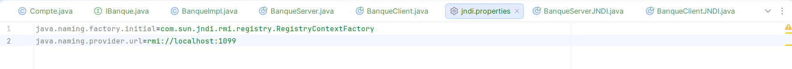
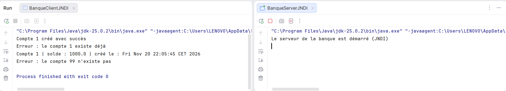

## Activité 5-2 : service de banque

- `Compte` : classe sérialisable (code, solde, date de création), envoyée par copie au serveur.
- `IBanque` : interface distante avec `creerCompte` et `getInfoCompte`.
- `BanqueImpl` : garde les comptes dans une `HashMap` et refuse de créer un compte dont le code existe déjà.
- `BanqueServer` et `BanqueClient` : version de l'étape 4, avec `LocateRegistry` et `Naming`.
- `BanqueServerJNDI` et `BanqueClientJNDI` : version de l'étape 5, avec JNDI (`InitialContext`).

Les deux versions ont été gardées dans le projet afin de montrer chaque étape du travail.

### Étape 4 : exécution avec le registre RMI (Naming)

Le serveur crée le registre avec `LocateRegistry.createRegistry(1099)` et publie l'objet avec `Naming.rebind`. Le client le récupère avec `Naming.lookup`.

### Étape 5 : exécution avec JNDI

Le fichier `jndi.properties` placé dans `src` configure l'annuaire :

Dans `BanqueServerJNDI`, l'objet est publié avec `InitialContext.rebind`. Dans `BanqueClientJNDI`, il est recherché avec `InitialContext.lookup`. Le résultat est identique à celui de l'étape 4.

