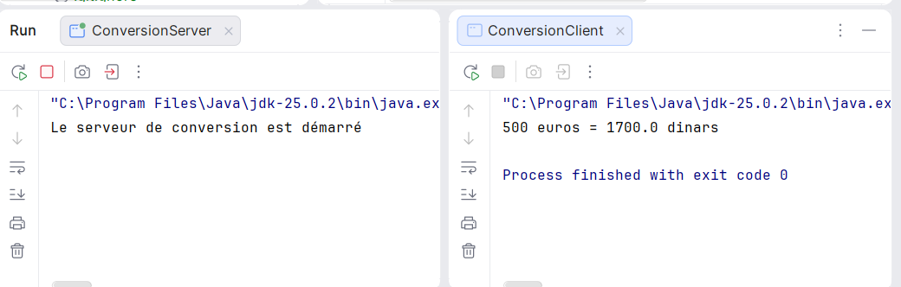
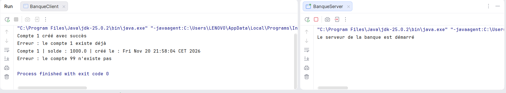

# TP5 - Invocation de méthodes sur des objets distants avec Java RMI

**Matière :** Développement d'applications réparties
**Auditoire :** LSI3
**Étudiant :** Abdelkefi Omar

## Structure du projet

- `src/activite51` : service de conversion de devise (RMI)
- `src/activite52` : service de banque (RMI puis JNDI)
- `images` : captures d'écran

Dans chaque activité, le package `commonPackage` contient l'interface distante (et la classe `Compte`) partagée par le client et le serveur. Il joue le rôle du fichier .jar exporté dans l'énoncé : le client ne connaît que l'interface, jamais la classe d'implémentation.

## Activité 5-1 : service de conversion de devise

- `IConversion` : interface distante avec la méthode `convertirMontant(double mt)`.
- `ConversionImpl` : implémentation du service, qui multiplie le montant en euros par le taux de 3,4.
- `ConversionServer` : active le registre RMI sur le port 1099, crée l'objet et le publie sous le nom `conversion`.
- `ConversionClient` : cherche l'objet dans l'annuaire et invoque `convertirMontant(500)`.

## Activité 5-2 : service de banque

- `Compte` : classe sérialisable (code, solde, date de création), envoyée par copie au serveur.
- `IBanque` : interface distante avec `creerCompte` et `getInfoCompte`.
- `BanqueImpl` : garde les comptes dans une `HashMap` et refuse de créer un compte dont le code existe déjà.
- `BanqueServer` et `BanqueClient` : version de l'étape 4, avec `LocateRegistry` et `Naming`.
- `BanqueServerJNDI` et `BanqueClientJNDI` : version de l'étape 5, avec JNDI (`InitialContext`).

Les deux versions ont été gardées dans le projet afin de montrer chaque étape du travail.

### Étape 4 : exécution avec le registre RMI (Naming)

Le serveur crée le registre avec `LocateRegistry.createRegistry(1099)` et publie l'objet avec `Naming.rebind`. Le client le récupère avec `Naming.lookup`.

### Étape 5 : exécution avec JNDI

Le fichier `jndi.properties` placé dans `src` configure l'annuaire :

Dans `BanqueServerJNDI`, l'objet est publié avec `InitialContext.rebind`. Dans `BanqueClientJNDI`, il est recherché avec `InitialContext.lookup`. Le résultat est identique à celui de l'étape 4.

## Synthèse

- Avec RMI, le client appelle une méthode distante presque comme une méthode locale : les sockets, la sérialisation des paramètres et le transport sont cachés.
- Le cycle d'un service distant : définir l'interface (qui étend `Remote`), l'implémenter (`UnicastRemoteObject`), publier l'objet dans l'annuaire, puis le chercher et l'invoquer côté client.
- Les paramètres passés par valeur, comme `Compte`, doivent être `Serializable`, car l'objet est copié vers le serveur et non partagé.
- JNDI ajoute une couche d'abstraction : le code utilise `InitialContext` et le fichier `jndi.properties` décide du type d'annuaire. On peut changer d'annuaire sans modifier le code.
- Le serveur doit être lancé en premier, sinon le client échoue au `lookup`.